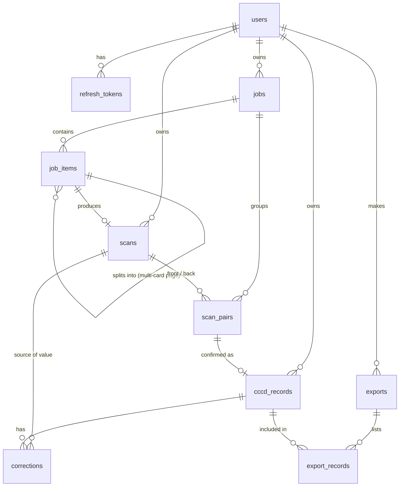

# VieScanner — Quy hoạch tổng thể (Master Plan v2)

> Phạm vi: toàn bộ luồng **đầu vào (quét camera / upload / import) → xử lý ML/DL hai mặt CCCD → ghép & hợp nhất → trả kết quả → lưu trữ / xuất file**, kèm thiết kế **database**, API, frontend, bảo mật, hiệu năng, kiểm thử, triển khai và lộ trình.
> Ngày lập: 2026-10-10. Căn cứ: code hiện tại (Session 24, chưa commit S21–24) + các tài liệu `PROJECT_ROADMAP.md`, `backend/README.md`, `docs/OCR_PIPELINE.md`.
> Ký hiệu: **[Có]** đã có · **[Sửa]** có, cần mở rộng · **[Mới]** làm mới.

---

## Mục lục

1. Mục tiêu, phạm vi & quyết định
2. Kiến trúc tổng thể
3. Luồng nghiệp vụ end-to-end
4. Tầng đầu vào (Frontend capture/upload/import)
5. Tầng tiếp nhận & xử lý bất đồng bộ (Job)
6. Pipeline ML/DL
7. Ghép cặp, hợp nhất (fusion) & quy tắc nghiệp vụ
8. Kết quả, review & xuất file
9. Database (thiết kế đầy đủ + migration)
10. API (đặc tả đầy đủ)
11. Frontend (routes, components, state)
12. Cấu hình (env)
13. Bảo mật & quyền riêng tư
14. Hiệu năng & khả năng mở rộng
15. Dữ liệu huấn luyện, đánh giá & vòng lặp học
16. Kiểm thử
17. Quan sát (logging/metrics)
18. Triển khai
19. Lộ trình sprint & Definition of Done
20. Rủi ro
21. Đối chiếu backlog cũ

---

## 1. Mục tiêu, phạm vi & quyết định

### 1.1 Mục tiêu

- Nhận CCCD từ **3 kênh**: quét camera trực tiếp, upload ảnh, import file (ZIP/PDF/nhiều ảnh) — **có cả mặt trước và mặt sau, lẫn lộn, không theo thứ tự**.
- Tự nhận diện **mặt** (trước/sau) và **loại thẻ**, tự **ghép cặp** hai mặt của cùng một người.
- Trích xuất **toàn bộ trường** của hai mặt, hợp nhất nhiều nguồn (QR, MRZ, OCR), kèm **confidence + nguồn + cảnh báo** cho từng trường.
- Cho người dùng review/sửa, lưu hồ sơ, **xuất Excel nhiều dòng** (và CSV/JSON).
- Ghi lại các sửa đổi để **đánh giá & cải thiện mô hình**.

### 1.2 Loại thẻ hỗ trợ

| Mã `card_type` | Thẻ | Mặt trước có | Mặt sau có | Ưu tiên |
|---|---|---|---|---|
| `cccd_2016` | CCCD mã vạch (2016–2020) | Số, họ tên, ngày sinh, giới tính, quốc tịch, quê quán, thường trú, hạn | Đặc điểm nhận dạng, ngày cấp, nơi cấp, vân tay, (mã vạch 1D) | P1 |
| `cccd_chip` | CCCD gắn chip (2021–6/2024) | Như trên + **QR** | Đặc điểm nhận dạng, ngày cấp, nơi cấp, vân tay, **MRZ 3 dòng** | P0 (dataset hiện có) |
| `cancuoc_2024` | Thẻ Căn cước (từ 7/2024) | Số, họ tên, ngày sinh, giới tính, quốc tịch (+QR) | Nơi cư trú, nơi đăng ký khai sinh, ngày cấp, ngày hết hạn, **MRZ** | P2 — *layout cần xác minh bằng ảnh mẫu thật* |
| `other` | CMND 9 số, giấy tờ khác, không phải thẻ | — | — | Từ chối (`unsupported_document`) |

### 1.3 Quyết định (mặc định đề xuất — có thể đổi)

| # | Quyết định | Mặc định | Lý do |
|---|---|---|---|
| D1 | Đọc **MRZ** mặt sau | **Có** (đảo lại mục "SKIP MRZ" của roadmap cũ) | Checksum ICAO → độ tin cậy gần tuyệt đối, chi phí thấp |
| D2 | Phân loại mặt/loại thẻ | **Rule-based trước** (QR/MRZ/từ khóa), **CNN sau** | Chạy được ngay, không cần dataset; CNN khi đủ ảnh |
| D3 | Xử lý nhiều ảnh | **Job bất đồng bộ** (in-process queue, không Celery) | Real OCR ~16 s/ảnh → request đồng bộ timeout |
| D4 | Lưu ảnh gốc | **Không lưu lâu dài**; chỉ thư mục tạm có TTL trong lúc job chạy | PII; giữ nguyên nguyên tắc dự án |
| D5 | DB | SQLite (dev/demo) + Postgres (prod), cùng migration | Hiện trạng đã hỗ trợ cả hai |
| D6 | LLM fallback (L3) | **Tùy chọn**, tắt mặc định | Chi phí, PII gửi ra ngoài |

### 1.4 Ngoài phạm vi (giữ như roadmap cũ)

NFC đọc chip, phát hiện giả mạo/watermark, multi-tenant, k8s, B2B webhook, GDPR/NĐ13 audit đầy đủ.

---

## 2. Kiến trúc tổng thể

```text
┌───────────────────────────── Browser (Next.js 16) ─────────────────────────────┐
│ /scan (camera)   /upload (ảnh, ZIP, PDF, HEIC)   /jobs/[id] (tiến độ + review)  │
│ /records (tìm kiếm, phân trang, xuất hàng loạt)  /history  /stats  /login       │
│ Web Workers: frame-quality, compress     SWR cache     lib/api.ts (timeout)     │
└───────────────┬─────────────────────────────────────────────────────────────────┘
                │ HTTPS (bắt buộc cho camera trên mobile)
┌───────────────▼──────────────── nginx ──────────────────────────────────────────┐
└───────────────┬─────────────────────────────────────────────────────────────────┘
┌───────────────▼──────────────── FastAPI ────────────────────────────────────────┐
│ controllers/  ocr · jobs · pairs · export · records · scans · auth · stats      │
│ services/                                                                        │
│   intake/      file_intake (validate, unzip, pdf→ảnh, heic→jpg)                  │
│   jobs/        job_service, job_worker (asyncio queue + semaphore), tmp_store   │
│   ocr/         pipeline + stages (classifier, aligner, cleaner, detector,        │
│                recognizer, front_extractor, back_extractor, qr, mrz)             │
│   fusion/      pairing, field_fusion, business_rules, confidence                 │
│   export/      excel/csv/json multi-record                                       │
│   retention, auth_service, image_quality                                         │
│ db/ models · repositories · migrations (Alembic)                                 │
└───────┬───────────────────────────────┬─────────────────────────────────────────┘
        │                               │
   SQLite / Postgres               tmp/jobs/<job_id>/ (TTL, xóa khi xong)
                                   weights/ (YOLO crop, side_cls, …)
```

Nguyên tắc giữ nguyên: Controller mỏng → Service (không biết HTTP) → Repository; mọi stage OCR là **Protocol + Mock + Real** inject qua DI (`ocr_engine.py`).

---

## 3. Luồng nghiệp vụ end-to-end

### 3.1 Luồng A — Quét camera (1 người, 2 mặt)

```text
User mở /scan → cấp quyền camera
 → Bước 1 "Mặt trước": khung hướng dẫn; worker đo nét/sáng/lóa/ổn định mỗi ~200 ms
 → đủ N khung liên tiếp đạt → tự chụp full-res → xem nhanh → [Dùng ảnh] / [Chụp lại]
 → POST /api/extract?side=front  → {scan_id, data, confidences, sources}
 → Bước 2 "Lật thẻ – mặt sau" (tương tự) → POST /api/extract?side=back
 → POST /api/pairs {front_scan_id, back_scan_id} → hồ sơ đã hợp nhất
 → Review form → [Lưu] POST /api/pairs/{id}/confirm → record → [Xuất Excel]
```
Ghi chú: kênh này **biết sẵn mặt và cặp** → không cần classifier/pairing tự động, chất lượng ảnh tốt nhất. Có thể bỏ qua bước 2 (thẻ chỉ cần mặt trước).

### 3.2 Luồng B — Upload ảnh (1..n ảnh)

```text
Chọn/kéo-thả ảnh (jpg/png/webp/heic) → tùy chọn gán mặt từng ảnh (mặc định "Tự nhận")
 → client: xoay EXIF, nén (worker), tiền kiểm chất lượng
 → POST /api/jobs (files[], sides[]) → 202 {job_id}
 → chuyển /jobs/{id}: thanh tiến độ từng ảnh (poll 1.5 s / SSE)
 → job xong → danh sách hồ sơ đã ghép + ảnh lẻ chưa ghép
 → review/ghép tay → confirm từng hồ sơ hoặc "Lưu tất cả hồ sơ đạt" → xuất Excel
```

### 3.3 Luồng C — Import file (ZIP / PDF / thư mục)

```text
Chọn .zip / .pdf / nhiều file → POST /api/jobs (source=import_zip|import_pdf)
 → backend: kiểm tra an toàn → bung ZIP / render PDF từng trang (200 DPI)
   → mỗi ảnh/trang thành 1 job_item (giữ thứ tự + tên file + số trang)
 → (giống luồng B từ bước xử lý)
```
Thứ tự trong ZIP/PDF và tên file (`*_front`, `*_back`, `1a/1b`, `truoc/sau`) là tín hiệu phụ cho ghép cặp.

### 3.4 Luồng xử lý một ảnh (dùng chung)

```text
bytes → decode + xoay EXIF + resize (OCR_MAX_IMAGE_SIDE_PX)
 → ① Quality gate (hard → rejected, soft → warning)
 → ② Classifier: side ∈ {front, back}, card_type, orientation
 → ③ Aligner YOLO 4 góc + warp (xoay 180° nếu orientation lật)
 → ④ Mã máy: front → QR · back → MRZ (+ checksum)
 → ⑤ Cleaner → ⑥ Detector → ⑦ Recognizer
 → ⑧ Extractor theo (side, card_type)
 → kết quả từng ảnh: fields + confidences + sources + bboxes + trace
 → lưu scans (background) 
```

---

## 4. Tầng đầu vào (Frontend)

### 4.1 Quét camera [Mới]

| Hạng mục | Thiết kế |
|---|---|
| API | `navigator.mediaDevices.getUserMedia({ video: { facingMode: "environment", width: { ideal: 1920 }, height: { ideal: 1080 } } })` |
| Khung hướng dẫn | Overlay chữ nhật tỉ lệ 85.6 : 54 (≈1.585), chiếm ~80 % chiều ngang; tô viền đỏ/vàng/xanh theo trạng thái |
| Đo chất lượng khung | Web Worker nhận `ImageBitmap` thu nhỏ (~320 px): Laplacian variance (nét), mean luma (sáng), tỉ lệ pixel > 245 (lóa), chênh lệch khung liên tiếp (ổn định) — **cùng công thức với `lib/quality.ts`** |
| Tự chụp | Khi đạt ngưỡng **liên tục ≥ 6 khung (~1.2 s)** → chụp full-res (`ImageCapture.takePhoto()` nếu có, fallback vẽ `video` lên canvas) |
| Thông điệp | "Đưa thẻ vào khung", "Giữ yên", "Bị lóa – nghiêng nhẹ thẻ", "Thiếu sáng" |
| Chế độ tay | Nút chụp thủ công luôn có (thiết bị yếu/không có worker) |
| Bước | Stepper `Mặt trước → Mặt sau → Xem lại`; cho phép "Bỏ qua mặt sau" |
| Điều kiện | Chỉ chạy trên **HTTPS hoặc localhost** → test mobile qua LAN cần `mkcert`/tunnel |
| Fallback | Không có camera/không cấp quyền → chuyển sang `<input type="file" accept="image/*" capture="environment">` |

### 4.2 Upload ảnh [Sửa]

- Giữ `ImageUpload.tsx` (drag-drop, `multiple`). Mở rộng `accept`: `image/jpeg,image/png,image/webp,image/heic,.zip,.pdf`.
- Mỗi thumbnail có select **Mặt: Tự nhận / Trước / Sau** và nút xóa.
- Tiền xử lý: xoay EXIF, resize/nén **trong Web Worker + OffscreenCanvas** (backlog N2); HEIC: gửi nguyên cho backend chuyển đổi (trình duyệt đa số không decode HEIC).
- Tiền kiểm `lib/quality.ts` [Có] → ảnh hard-reject hiển thị lý do ngay, không gửi.

### 4.3 Import file [Mới]

- ZIP và PDF **không xử lý ở client** (gửi nguyên). Giới hạn client: ≤ `IMPORT_MAX_FILE_MB` (mặc định 50 MB) mỗi file.
- Upload có progress (`XMLHttpRequest.upload.onprogress` hoặc fetch + stream) vì file lớn.

---

## 5. Tầng tiếp nhận & xử lý bất đồng bộ (Job) [Mới]

### 5.1 File intake (`services/intake/file_intake.py`)

| Loại | Xử lý | Giới hạn an toàn |
|---|---|---|
| Ảnh jpg/png/webp | Kiểm magic bytes (đã có `utils/image.py`) | ≤ `MAX_UPLOAD_SIZE_MB` |
| HEIC/HEIF | `pillow-heif` → JPEG | như ảnh |
| ZIP | `zipfile`; bỏ `__MACOSX/`, file ẩn, thư mục; chỉ nhận đuôi ảnh/PDF; sắp theo tên tự nhiên | ≤ `IMPORT_ZIP_MAX_ENTRIES` (200), tổng giải nén ≤ `IMPORT_MAX_UNCOMPRESSED_MB` (300), tỉ lệ nén ≤ 100 (chống zip-bomb), chặn path traversal (không ghi theo tên trong ZIP — đặt tên nội bộ) |
| PDF | `PyMuPDF` render từng trang `IMPORT_PDF_DPI` (200) → PNG | ≤ `IMPORT_PDF_MAX_PAGES` (100); *PyMuPDF giấy phép AGPL — chấp nhận cho đồ án; thay `pypdfium2` (Apache/BSD) nếu phát hành* |
| Khác | Từ chối item với `unsupported_file` | — |

Một trang PDF/A4 có thể chứa **cả 2 mặt** (photocopy CCCD kiểu phổ biến) → bước ③ phải hỗ trợ **nhiều thẻ trong một ảnh** (xem 6.3).

### 5.2 Job service & worker

```text
POST /api/jobs   (tổng body ≤ MAX_REQUEST_MB, chặn ngay từ header Content-Length)
  ├─ chép từng file gốc theo khối 1MB vào tmp/jobs/<job_id>/upload-<i>.bin (không nạp cả file vào RAM)
  ├─ nhận diện định dạng, đếm trang PDF (không render) → job_items(status=queued, filename, page)
  ├─ đẩy item_id vào asyncio.Queue
  └─ trả 202 {job_id, items:[…]}   (PDF 100 trang: ~3s thay vì 13s khi render ngay trong request)

JobWorker (khởi động trong lifespan, N task = OCR_MAX_CONCURRENCY)
  loop: item = await queue.get()
        → status=processing → chuẩn bị ảnh: render trang PDF / đổi HEIC / tách ảnh nhiều thẻ
          (nhiều thẻ: thay item bằng 1 item mỗi thẻ, ảnh thẻ ghi <item_id>.bin, rồi đưa lại vào hàng đợi)
        → chạy pipeline 1 ảnh (mục 3.4)
        → ghi scans + cập nhật job_items (status, scan_id, error)
        → tăng jobs.processed_items (atomic UPDATE … SET x = x + 1)
        → nếu item cuối: chạy pairing + fusion (mục 7) → ghi scan_pairs
          → jobs.status = completed | partial | failed → xóa tmp
```

- **Khôi phục khi restart**: lúc startup, item `processing` → `queued` nếu file tmp còn, ngược lại `failed (tmp_lost)`; đưa lại vào queue.
- **Hủy job**: `POST /api/jobs/{id}/cancel` → item `queued` thành `cancelled`; worker kiểm tra cờ trước khi xử lý.
- **TTL**: `JOB_TTL_MINUTES` (60) → job retention task (mở rộng `services/retention.py`) xóa thư mục tmp và đánh dấu `expired`.
- **Tiến độ**: `GET /api/jobs/{id}` (poll 1.5 s) — SSE `/events` là tùy chọn.
- `/api/extract-batch` [Có] giữ lại, nội bộ chuyển thành "job chạy đồng bộ ≤ 5 ảnh" để tương thích ngược; đánh dấu deprecated trong docs.

---

## 6. Pipeline ML/DL

### 6.1 Tổng quan stage

| # | Stage | Kỹ thuật/mô hình | Input → Output | Trạng thái |
|---|---|---|---|---|
| 0 | Decode/chuẩn hóa | OpenCV + EXIF transpose + resize | bytes → BGR | [Sửa] thêm EXIF/HEIC |
| ① | Quality gate | OpenCV metrics + YOLO đếm góc | BGR → QualityReport | [Có] |
| ② | **SideClassifier** | v1 rule; v2 **YOLOv8n-cls** | BGR → `{side, card_type, orientation, conf}` | [Mới] |
| ③ | CardAligner | YOLO `model_crop.pt` 4 góc + warp | BGR → thẻ thẳng (chuẩn hóa **1000×630**) | [Sửa] multi-card, mặt sau |
| ④a | QRReader | `cv2.QRCodeDetector` (+ thử `QRCodeDetectorAruco`) | front → QR fields | [Có] map thêm `issue_date`, `old_id_number` |
| ④b | **MRZReader** | Định vị ROI + OCR + checksum ICAO 9303 TD1 | back → MRZ fields | [Mới] |
| ⑤ | Cleaner | OpenCV khử bóng + tương phản | → RGB sạch | [Có] |
| ⑥ | Detector | PaddleOCR PP-OCRv5 det (DBNet) | → BBox[] | [Có] |
| ⑦ | Recognizer | VietOCR vgg_transformer, `predict_batch` | → TextLine[] | [Có] |
| ⑧ | **Extractor** | Rule (regex + nhãn + fuzzy) theo `(side, card_type)` | → fields + conf + bbox | [Sửa] tách Front/Back |
| ⑨ | LLM fallback | VLM/LLM chỉ cho field rỗng | — | [Mới, tùy chọn] |

Interface mới trong `services/ocr/interfaces.py`:

```python
class SideClassifier(Protocol):
    def classify(self, image: ImageArray) -> SideResult: ...      # side, card_type, orientation, confidence

class MRZReader(Protocol):
    def read(self, aligned: ImageArray) -> MRZResult | None: ...  # fields + per-line checksum flags

class Extractor(Protocol):                                         # giữ nguyên chữ ký
    def extract(self, lines: list[TextLine]) -> ExtractionResult: ...
# ExtractionResult bổ sung: bboxes: dict[str, BBox], sources: dict[str, str]
```

`OCRPipeline` đổi thành **router**: chọn `FrontExtractor | BackExtractor` (và biến thể theo `card_type`) dựa trên kết quả ②; trả về `ImageResult` (khác `CCCDExtractResponse` cũ: không ép `CCCDData` đầy đủ vì một mặt không đủ trường bắt buộc).

### 6.2 ② SideClassifier

**v1 — Rule-based (làm ngay):**

| Tín hiệu | Kết luận | Conf |
|---|---|---|
| Đọc được QR CCCD hợp lệ | front, `cccd_chip`/`cancuoc_2024` | 0.99 |
| Tìm thấy MRZ `IDVNM…` (≥ 2 dòng, checksum số định danh đúng) | back, chip/2024 | 0.99 |
| Sau OCR: có nhãn "Họ và tên"/"Full name" + "Ngày sinh" | front | 0.9 |
| Sau OCR: có "Đặc điểm nhận dạng"/"Personal identification" hoặc "Ngày, tháng, năm"+"Cục trưởng" | back | 0.9 |
| Có "Nơi cư trú" + "Nơi đăng ký khai sinh" | back, `cancuoc_2024` | 0.85 |
| Có "CĂN CƯỚC CÔNG DÂN" | `cccd_*`; có "CĂN CƯỚC" (không "CÔNG DÂN") | `cancuoc_2024` | 0.8 |
| Không gì khớp | `unknown` → `needs_review` | — |

Nhược điểm v1: phải chạy OCR trước mới biết mặt (với thẻ không QR/MRZ) → thứ tự thực tế: ④ → nếu chưa chắc thì ⑤–⑦ → phân loại theo từ khóa → ⑧.

**v2 — CNN (khi có ≥ 100 ảnh/lớp):**
- Mô hình: `yolov8n-cls` (ultralytics đã có sẵn), imgsz 224, ~3 MB, CPU ~10 ms.
- Lớp: `cccd_2016_front, cccd_2016_back, cccd_chip_front, cccd_chip_back, cancuoc_2024_front, cancuoc_2024_back, other` (7 lớp).
- Orientation: test-time 4 góc xoay (0/90/180/270), lấy xác suất cao nhất → biết hướng thẻ.
- Chạy **trên ảnh đã căn** (sau ③) để ổn định; nếu ③ thất bại thì chạy trên ảnh gốc.
- Config `OCR_SIDE_CLASSIFIER=rule|cnn|hybrid` (hybrid: CNN, nhưng QR/MRZ đè nếu có).

### 6.3 ③ CardAligner — mở rộng

- **Mặt sau**: kiểm tra tỉ lệ thành công của `model_crop.pt` trên ảnh mặt sau. Nếu < 85 % → gán nhãn 4 góc (Label Studio/Roboflow, ~150 ảnh) và fine-tune YOLO.
- **Nhiều thẻ trong 1 ảnh** (trang PDF photocopy 2 mặt): nhóm các góc phát hiện thành từng bộ 4 bằng khoảng cách/hình học; mỗi bộ → 1 thẻ con → `job_item` con (`parent_item_id`). v1: phát hiện > 4 góc cùng lớp → tách theo nửa trên/dưới ảnh.
- Chuẩn hóa kích thước output cố định **1000×630** → cho phép **ROI template** (tối ưu 14.2).

### 6.4 ④b MRZReader (TD1, 3 dòng × 30 ký tự)

```text
Dòng 1: I D V N M <số tài liệu 9 ký tự> <check> <dữ liệu tùy chọn: số định danh 12 số …>
Dòng 2: <YYMMDD sinh><check> <M|F> <YYMMDD hết hạn><check> VNM <…> <composite check>
Dòng 3: HO<<TEN<DEM<TEN   (không dấu)
```
*Bố cục vị trí cụ thể của số 12 chữ số trong dòng 1 cần xác minh trên ảnh mẫu thật trước khi chốt parser.*

- ROI: 1/3 dưới ảnh đã căn (template theo `card_type`); nhị phân hóa + tăng tương phản.
- OCR: PaddleOCR recognizer tiếng Anh (đã có Paddle) với whitelist `A-Z0-9<`; fallback Tesseract (`OCR_MRZ_ENGINE`).
- Sửa lỗi ký tự theo vị trí: ở trường số thay `O→0, I→1, B→8, S→5`; ở trường chữ thay ngược lại.
- Checksum ICAO 7-3-1 cho: số tài liệu, ngày sinh, ngày hết hạn, composite. Kết quả `mrz_valid` + từng cờ.
- Output: `id_number`, `dob`, `gender`, `expiry_date`, `name_ascii`, `mrz_valid`, `mrz_checks`.

### 6.5 ⑧ Extractor theo mặt

| Extractor | Trường | Kỹ thuật chính |
|---|---|---|
| `FrontExtractor` [Có — đổi tên `RealFieldExtractor`] | id_number, full_name, dob, gender, nationality, origin, residence, expiry_date | Giữ nguyên 3 tầng regex/nhãn/fuzzy |
| `BackExtractor` [Mới] | `identifying_marks` (Đặc điểm nhận dạng), `issue_date` (Ngày, tháng, năm), `issue_place` (chức danh cơ quan cấp), với `cancuoc_2024`: `residence`, `birth_registration_place`, `expiry_date` | Nhãn + regex ngày `dd/mm/yyyy`; `issue_place` fuzzy-match với **từ điển cơ quan cấp** (≈5 chuỗi chuẩn) → chuẩn hóa |
| `Front2024Extractor` [Mới, P2] | id_number, full_name, dob, gender, nationality | Biến thể nhãn của thẻ 2024 |

Mọi extractor trả thêm `bboxes[field]` (hợp bbox các dòng tạo nên giá trị) phục vụ highlight trên UI.

### 6.6 Confidence từng ảnh

```text
conf_ocr(field) = min( mean(recognizer_prob của các dòng tạo field),
                       extractor_rule_conf(field) )      # 1.0 regex / 0.9 fuzzy / 0.6 vị trí / 0 không thấy
conf_qr  = 1.0   (payload QR parse hợp lệ)
conf_mrz = 0.98 nếu checksum trường đó đúng, 0.6 nếu sai
```
(Lưu ý hiện trạng: `predict_batch` cho prob thật; per-box + beamsearch prob = None → nên dùng batch để có confidence có nghĩa.)

---

## 7. Ghép cặp, hợp nhất (fusion) & quy tắc nghiệp vụ [Mới]

### 7.1 Ghép cặp (`services/fusion/pairing.py`)

Áp dụng sau khi toàn bộ item của job xử lý xong (hoặc tăng dần khi có item mới).

Điểm ghép `score(front f, back b)` = max các tín hiệu thỏa:

| Tín hiệu | Điểm |
|---|---|
| Người dùng gán / luồng camera | 1.00 |
| `id_number(f)` == `id_number(b)` (QR/OCR front vs MRZ back) | 0.98 |
| `ascii_upper(full_name(f))` == `name_ascii(b)` **và** `dob` trùng | 0.92 |
| Tên file cặp (`X_front`/`X_back`, `Xa`/`Xb`, `X_truoc`/`X_sau`, `X (1)`/`X (2)`) | 0.80 |
| Hai trang/ảnh liền kề, front trước back, cùng `card_type` | 0.60 |
| Cùng một trang PDF (2 thẻ con) | 0.70 |

Ràng buộc: mỗi front ↔ tối đa 1 back; cùng họ `card_type` (2016 với 2016; chip với chip; 2024 với 2024); **mâu thuẫn cứng** (id khác nhau rõ ràng giữa 2 nguồn checksum hợp lệ) → score = 0.
Thuật toán: ma trận điểm → **ghép tham lam theo điểm giảm dần** (đủ tốt với ≤ 200 ảnh; Hungarian nếu muốn tối ưu toàn cục). Cặp có score < `PAIR_MIN_SCORE` (0.6) → không ghép. Nếu một front có 2 ứng viên chênh < 0.05 → ghép nhưng `needs_review` + cảnh báo `ambiguous_pair`.
Item lẻ → hồ sơ `front_only` / `back_only`. UI cho phép kéo-thả ghép tay → `pair_method = manual`.

### 7.2 Hợp nhất trường (`services/fusion/field_fusion.py`)

Bảng ưu tiên nguồn (trái → phải):

| Trường | Ưu tiên nguồn | Ghi chú |
|---|---|---|
| `id_number` | QR → MRZ(valid) → OCR front | |
| `full_name` | QR → OCR front | MRZ (không dấu) chỉ để **đối chiếu** |
| `dob` | QR → MRZ(valid) → OCR front | |
| `gender` | QR → MRZ → OCR front | |
| `nationality` | OCR front → mặc định "Việt Nam" (conf 0.7) | |
| `origin` | OCR front | thẻ 2024 không có trường này |
| `residence` | QR → OCR front (2016/chip) / OCR back (2024) | |
| `expiry_date` | MRZ(valid) → OCR front/back | "Không thời hạn" → null + cờ |
| `issue_date` | QR → OCR back | |
| `issue_place` | OCR back (chuẩn hóa từ điển) | |
| `identifying_marks` | OCR back | |
| `birth_registration_place` | OCR back (2024) | |
| `old_id_number` | QR | |

Quy tắc kết hợp:
- Hai nguồn **đồng ý** → `conf = min(1, max(c1, c2) + 0.05)`.
- **Không đồng ý** → lấy nguồn ưu tiên, `conf × FUSION_DISAGREE_PENALTY (0.7)`, cảnh báo `source_mismatch` (ghi cả hai giá trị để UI hiển thị gợi ý).
- Lưu `field_sources[field] = "qr" | "mrz" | "ocr_front" | "ocr_back" | "default" | "manual"`.

### 7.3 Quy tắc nghiệp vụ / kiểm tra chéo (`services/fusion/business_rules.py`)

| Mã cảnh báo | Quy tắc | Hành động |
|---|---|---|
| `id_format` | 12 chữ số | conf id = 0 |
| `id_province` | 3 số đầu ∈ danh sách mã tỉnh hợp lệ (001…096) | × 0.5 |
| `id_gender_century` | Số thứ 4: 0/1 = Nam/Nữ thế kỷ 20, 2/3 = Nam/Nữ thế kỷ 21 (4/5… thế kỷ 22…) → khớp `gender` và thế kỷ năm sinh | × 0.5 cho trường mâu thuẫn |
| `id_birth_year` | Số thứ 5–6 = 2 số cuối năm sinh | × 0.5 |
| `expiry_rule` | Hạn = ngày sinh tại mốc tuổi 25/40/60 kế tiếp (cấp trong vòng 2 năm trước mốc thì sang mốc sau); ≥ 60 tuổi → không thời hạn | × 0.6 |
| `date_order` | dob < issue_date ≤ hôm nay; issue_date < expiry_date | × 0.5 |
| `expired_card` | expiry_date < hôm nay | chỉ cảnh báo (không hạ conf) |
| `name_mrz_mismatch` | `ascii(full_name)` ≠ `name_ascii` MRZ (so khớp fuzzy ≥ 90) | × 0.7 cho full_name |

### 7.4 Trạng thái hồ sơ

`complete` (đủ trường bắt buộc, mọi conf ≥ 0.7, không cảnh báo mức cao) · `needs_review` · `front_only` · `back_only` · `failed`.

---

## 8. Kết quả, review & xuất file

### 8.1 Payload một hồ sơ (`PairResult`)

```json
{
  "pair_id": "uuid",
  "status": "needs_review",
  "card_type": "cccd_chip",
  "pair_method": "id_match",
  "pair_score": 0.98,
  "front": { "scan_id": "uuid", "filename": "a.jpg", "quality": { }, "side_confidence": 0.99 },
  "back":  { "scan_id": "uuid", "filename": "b.jpg", "quality": { }, "side_confidence": 0.99 },
  "data": {
    "id_number": "001202000123", "full_name": "NGUYỄN VĂN A", "dob": "01/01/2000",
    "gender": "Nam", "nationality": "Việt Nam", "origin": "…", "residence": "…",
    "expiry_date": "01/01/2040", "issue_date": "10/05/2021", "issue_place": "…",
    "identifying_marks": "…", "old_id_number": null, "birth_registration_place": null
  },
  "confidences": { "id_number": 1.0, "origin": 0.62 },
  "sources": { "id_number": "qr", "expiry_date": "mrz", "issue_place": "ocr_back" },
  "bboxes": { "origin": { "scan_id": "uuid", "box": [120, 300, 860, 340] } },
  "warnings": [ { "code": "source_mismatch", "field": "dob", "values": { "qr": "01/01/2000", "ocr_front": "07/01/2000" } } ],
  "record_id": null
}
```

### 8.2 UI review

- Lưới hồ sơ: thumbnail 2 mặt, badge trạng thái, % trường xanh. Lọc: Tất cả / Cần xem lại / Lẻ / Lỗi.
- **Pair board**: cột "Chưa ghép" — kéo ảnh front lên ảnh back để ghép, nút "Tách cặp".
- Trang chi tiết: trái = ảnh (zoom, chuyển mặt), phải = form 13 trường; click trường → highlight bbox; badge confidence (giữ màu hiện có) + **badge nguồn** (QR/MRZ/OCR); cảnh báo `source_mismatch` hiển thị gợi ý giá trị thay thế (1 click áp dụng).
- Phím tắt: `Tab`/`Enter` qua trường thấp kế tiếp; `Ctrl+S` lưu; `→` hồ sơ tiếp.
- Hành động: "Lưu hồ sơ", "Lưu tất cả hồ sơ `complete`", "Xuất".

### 8.3 Xuất file [Sửa]

- `excel_service` → `export_service`: nhận **list records**; định dạng `xlsx | csv | json`.
- XLSX: sheet `Hồ sơ` (1 dòng/người, 13 cột + `Trạng thái`, `Cảnh báo`), sheet `Cần xem lại` (lọc), tùy chọn cột `conf_*`; định dạng ngày dd/mm/yyyy dạng text (tránh Excel tự đổi), cột số CCCD dạng text (giữ số 0 đầu), freeze header, auto width.
- CSV: UTF-8 **có BOM** (Excel mở đúng tiếng Việt).
- Đánh dấu `exported_at`, ghi bảng `exports`.

### 8.4 Ghi corrections

Khi confirm: diff `merged_data` (giá trị máy) vs dữ liệu người dùng lưu → mỗi trường khác → 1 dòng `corrections` với `source` + `scan_id` của **ảnh sinh ra giá trị đó** (lấy từ `field_sources`).

---

## 9. Database

### 9.1 Hiện trạng (migration `0001_initial`)

`users`, `scans`, `cccd_records`, `corrections` — UUID dạng `String(36)`, enum `native_enum=False` (tương thích SQLite), JSON cho `raw_data`/`confidences`.

Hạn chế so với yêu cầu mới: không có khái niệm job/batch, mặt thẻ, cặp; `cccd_records` thiếu trường mặt sau; `corrections` không biết nguồn; không có refresh token; không có index ghép cho cache; không soft delete; tìm kiếm không dấu chưa có.

### 9.2 ERD mục tiêu



### 9.3 Đặc tả bảng

Quy ước chung: PK `id String(36)` UUID4; thời gian `DateTime(timezone=True)`; enum `native_enum=False` + `CHECK`; JSON (`JSONB` trên Postgres qua `JSON().with_variant(JSONB, "postgresql")`).

#### `users` [Có — không đổi]

| Cột | Kiểu | Ràng buộc |
|---|---|---|
| id | String(36) | PK |
| email | String(320) | UNIQUE, index |
| password_hash | String(255) | NOT NULL |
| full_name | String(255) | NULL |
| role | enum(`admin`,`user`) | default `user` |
| is_active | Boolean | default true |
| created_at / updated_at | DateTime tz | default now |

#### `refresh_tokens` [Mới — O2]

| Cột | Kiểu | Ràng buộc |
|---|---|---|
| id | String(36) | PK (= `jti` trong JWT) |
| user_id | String(36) | FK users ON DELETE CASCADE, index |
| token_hash | String(64) | sha256 của token, UNIQUE |
| expires_at | DateTime tz | NOT NULL, index |
| revoked_at | DateTime tz | NULL |
| replaced_by_id | String(36) | NULL (rotation) |
| user_agent | String(255) | NULL |
| created_at | DateTime tz | default now |

Rotation: mỗi lần refresh → revoke token cũ, cấp token mới; dùng lại token đã revoke → revoke toàn chuỗi (phát hiện đánh cắp).

#### `jobs` [Mới]

| Cột | Kiểu | Ràng buộc / ghi chú |
|---|---|---|
| id | String(36) | PK |
| user_id | String(36) | FK users ON DELETE SET NULL, NULL (anonymous) |
| source | enum(`upload`,`import_zip`,`import_pdf`,`camera`,`legacy_batch`) | NOT NULL |
| status | enum(`queued`,`processing`,`completed`,`partial`,`failed`,`cancelled`,`expired`) | index |
| total_items | Integer | default 0 |
| processed_items | Integer | default 0 |
| succeeded_items | Integer | default 0 |
| failed_items | Integer | default 0 |
| options | JSON | `{force_side?, fast_mode?, …}` |
| error_code / error_message | String(64) / Text | NULL |
| ocr_engine | String(32) | mock/real |
| created_at | DateTime tz | default now |
| started_at / finished_at | DateTime tz | NULL |
| expires_at | DateTime tz | index (dọn tmp + retention) |

Index: `(user_id, created_at DESC)`, `status`.

#### `job_items` [Mới]

| Cột | Kiểu | Ràng buộc / ghi chú |
|---|---|---|
| id | String(36) | PK |
| job_id | String(36) | FK jobs ON DELETE CASCADE, index |
| parent_item_id | String(36) | FK job_items NULL (thẻ con tách từ 1 ảnh/trang) |
| seq | Integer | thứ tự trong job (sau khi bung ZIP/PDF) |
| original_filename | String(255) | tên file người dùng / tên trong ZIP |
| container_filename | String(255) | NULL — tên ZIP/PDF chứa nó |
| page_number | Integer | NULL — trang PDF |
| side_hint | enum(`auto`,`front`,`back`) | default `auto` (người dùng gán) |
| status | enum(`queued`,`processing`,`done`,`rejected`,`failed`,`cancelled`) | index |
| scan_id | String(36) | FK scans ON DELETE SET NULL, NULL |
| error_code / error_message | String(64) / Text | NULL |
| created_at / updated_at | DateTime tz | |

UNIQUE `(job_id, seq)`.

#### `scans` [Sửa]

Giữ toàn bộ cột cũ, **thêm**:

| Cột mới | Kiểu | Ghi chú |
|---|---|---|
| job_id | String(36) | FK jobs ON DELETE SET NULL, NULL, index |
| side | enum(`front`,`back`,`unknown`) | default `front` (dữ liệu cũ đều là mặt trước) |
| side_source | enum(`user`,`camera`,`qr`,`mrz`,`keywords`,`cnn`) | NULL |
| side_confidence | Float | NULL |
| card_type | String(32) | NULL — `cccd_2016`/`cccd_chip`/`cancuoc_2024`/`other` |
| orientation | SmallInteger | 0/90/180/270 |
| qr_found | Boolean | default false |
| mrz_valid | Boolean | NULL (mặt trước) |
| field_sources | JSON | `{field: source}` |
| bboxes | JSON | `{field: [x1,y1,x2,y2]}` trên ảnh đã căn |
| quality | JSON | QualityReport (hiện chỉ trả về, chưa lưu) |
| stage_ms | JSON | trace thời gian từng stage |
| model_versions | JSON | `{aligner: "model_crop@sha", side_cls: "v2@…", recognizer: "vgg_transformer"}` |

Ý nghĩa `raw_data`: kết quả trích xuất **của riêng ảnh này** (một mặt) — không còn ép đủ `CCCDData`.
`status` thêm giá trị `rejected` (quality hard) để tách khỏi `failed` (OCR lỗi).
Index thêm: **`(image_hash, user_id, status, created_at)`** (O4 — query cache), `(job_id)`.
Cache theo `image_hash` (M6) giữ nguyên ý nghĩa, nhưng **khóa cache = (image_hash, side_hint)**.

#### `scan_pairs` [Mới]

| Cột | Kiểu | Ràng buộc / ghi chú |
|---|---|---|
| id | String(36) | PK |
| job_id | String(36) | FK jobs ON DELETE CASCADE, NULL (cặp ad-hoc từ camera) |
| user_id | String(36) | FK users ON DELETE SET NULL, NULL |
| front_scan_id | String(36) | FK scans ON DELETE SET NULL, NULL |
| back_scan_id | String(36) | FK scans ON DELETE SET NULL, NULL |
| card_type | String(32) | NULL |
| pair_method | enum(`camera`,`user`,`manual`,`id_match`,`name_dob_match`,`filename`,`sequence`,`same_page`,`single`) | |
| pair_score | Float | |
| status | enum(`complete`,`needs_review`,`front_only`,`back_only`,`failed`,`confirmed`) | index |
| merged_data | JSON | dữ liệu sau fusion (giá trị máy) |
| confidences | JSON | |
| field_sources | JSON | |
| warnings | JSON | list cảnh báo |
| record_id | String(36) | FK cccd_records ON DELETE SET NULL, NULL |
| created_at / updated_at | DateTime tz | |

CHECK: `front_scan_id IS NOT NULL OR back_scan_id IS NOT NULL`.
UNIQUE (partial trên Postgres; kiểm tra ở service với SQLite): một scan chỉ thuộc **1 cặp đang hoạt động**.

#### `cccd_records` [Sửa]

Giữ cột cũ (`scan_id` giữ lại, nghĩa = **scan mặt trước**, tương thích API cũ), **thêm**:

| Cột mới | Kiểu | Ghi chú |
|---|---|---|
| pair_id | String(36) | FK scan_pairs ON DELETE SET NULL, NULL, index |
| back_scan_id | String(36) | FK scans ON DELETE SET NULL, NULL |
| card_type | String(32) | NULL |
| old_id_number | String(9) | NULL (CMND cũ từ QR) |
| issue_date | Date | NULL |
| issue_place | Text | NULL |
| identifying_marks | Text | NULL |
| birth_registration_place | Text | NULL (thẻ 2024) |
| no_expiry | Boolean | default false ("Không thời hạn") |
| origin | Text | **đổi thành NULL được** (thẻ 2024 không có) |
| source | enum(`ocr`,`manual`) | default `ocr` |
| search_text | Text | chuỗi chuẩn hóa: lowercase **không dấu** của `id_number + full_name` → tìm kiếm không dấu chạy được cả SQLite |
| deleted_at | DateTime tz | NULL — **soft delete** |

Index: `(user_id, created_at DESC)`, `id_number`, `search_text` (Postgres: thêm `pg_trgm` GIN nếu cần), `deleted_at`.
Repository mặc định lọc `deleted_at IS NULL`.

#### `corrections` [Sửa]

| Cột mới | Kiểu | Ghi chú |
|---|---|---|
| record_id | String(36) | FK cccd_records ON DELETE CASCADE, NULL, index |
| pair_id | String(36) | FK scan_pairs ON DELETE SET NULL, NULL |
| side | enum(`front`,`back`) | NULL |
| source | String(16) | nguồn giá trị máy (`qr`/`mrz`/`ocr_front`/`ocr_back`/`default`) |

`scan_id` đổi thành **NULL được** + `ON DELETE SET NULL` (hiện là CASCADE → retention xóa scan sẽ mất dữ liệu sửa lỗi quý cho đánh giá). Index thêm `(field_name, source)`.

#### `exports` [Mới]

| Cột | Kiểu | Ghi chú |
|---|---|---|
| id | String(36) | PK |
| user_id | String(36) | FK users ON DELETE SET NULL, NULL |
| format | enum(`xlsx`,`csv`,`json`) | |
| record_count | Integer | |
| filename | String(255) | |
| created_at | DateTime tz | |

#### `export_records` [Mới]

| Cột | Kiểu |
|---|---|
| export_id | FK exports ON DELETE CASCADE (PK phần 1) |
| record_id | FK cccd_records ON DELETE CASCADE (PK phần 2) |

#### (Tùy chọn) `audit_logs`

`id, user_id, action, entity, entity_id, meta JSON, ip, created_at` — chỉ làm nếu còn thời gian (ngoài phạm vi chính).

### 9.4 Kế hoạch migration (Alembic)

SQLite không hỗ trợ ALTER đầy đủ → mọi thay đổi bảng cũ dùng **`op.batch_alter_table`**.

| Revision | Nội dung | Data migration |
|---|---|---|
| `0002_jobs_and_sides` | Tạo `jobs`, `job_items`; thêm cột mới vào `scans`; index `(image_hash,user_id,status,created_at)` | `scans.side='front'` cho dữ liệu cũ |
| `0003_pairs_and_back_fields` | Tạo `scan_pairs`; thêm cột vào `cccd_records`; `origin` nullable; sửa `corrections` | Với mỗi record cũ có `scan_id`: tạo `scan_pairs(front_scan_id=scan_id, pair_method='single', status='confirmed', record_id=…)`; tính `search_text` |
| `0004_auth_exports` | `refresh_tokens`, `exports`, `export_records` | — |

Mỗi revision có `downgrade()` đầy đủ; kiểm thử chu trình `upgrade head → downgrade base → upgrade head` trên SQLite và Postgres (CI job dùng service Postgres).

### 9.5 Repository & truy vấn chính

| Repository | Hàm mới |
|---|---|
| `JobRepository` | `create_with_items`, `get_with_items`, `incr_progress` (UPDATE atomic), `mark_status`, `list_by_user(limit, offset)`, `requeue_stale`, `list_expired` |
| `ScanRepository` | `create_scan(..., side, card_type, job_id, …)`, `get_latest_success_by_image_hash(hash, user, side)` |
| `PairRepository` [Mới] | `bulk_create`, `get`, `update_members` (ghép tay), `list_by_job`, `confirm(record_id)` |
| `CCCDRecordRepository` | `search(user, q, from, to, status, limit, offset) → (items, total)`, `soft_delete`, `get_many(ids)` |
| `CorrectionRepository` | `bulk_insert(..., source, side, record_id)`, `stats_by_field(source)` |
| `RefreshTokenRepository` | `issue`, `rotate`, `revoke_chain`, `purge_expired` |

Tìm kiếm: `q` → chuẩn hóa (bỏ dấu, lowercase) → `search_text LIKE '%q%'`; trả `X-Total-Count`.

### 9.6 Vòng đời dữ liệu & retention

| Dữ liệu | Giữ bao lâu | Cơ chế |
|---|---|---|
| Ảnh tạm của job | đến khi job xong, tối đa `JOB_TTL_MINUTES` | xóa thư mục tmp |
| `jobs`, `job_items` | `JOB_RETENTION_DAYS` (7) | retention loop |
| `scans` | `SCAN_RETENTION_DAYS` (0 = giữ) [Có] | đổi: không xóa corrections (SET NULL) |
| `scan_pairs` chưa confirm | theo job | CASCADE từ jobs |
| `cccd_records` | đến khi người dùng xóa; soft delete → purge sau `RECORD_PURGE_DAYS` (30) | retention loop |
| `refresh_tokens` hết hạn | purge hằng ngày | retention loop |

### 9.7 Postgres production (M7)

`create_async_engine(..., pool_size=5, max_overflow=10, pool_recycle=1800, pool_pre_ping=True)` qua env `DB_POOL_SIZE`, `DB_MAX_OVERFLOW`, `DB_POOL_RECYCLE`; chỉ áp khi URL không phải SQLite. Supabase: dùng pooler port 6543 + `statement_cache_size=0` cho asyncpg (pgbouncer transaction mode).

---

## 10. API (đặc tả đầy đủ)

Tất cả dưới `/api`, lỗi theo hợp đồng hiện có `{code, message, request_id, details}`.

### 10.1 Giữ nguyên / mở rộng

| Method | Path | Thay đổi |
|---|---|---|
| GET | `/health` | thêm `job_queue_size`, `models: {side_cls, mrz}` |
| POST | `/extract` | [Sửa] thêm query `side=auto|front|back`; response thêm `side`, `card_type`, `sources`, `bboxes`, `warnings`. **Giữ** trường `data` kiểu `CCCDData` khi `side=front` để FE cũ không vỡ |
| POST | `/extract-batch` | [Deprecated] wrapper job đồng bộ ≤ 5 ảnh |
| POST | `/export` | [Sửa] nhận 1 trong: `{data, scan_id}` (cũ) · `{records:[CCCDFull]}` · `{record_ids:[…]}`; query `format=xlsx|csv|json`, `include_confidence=bool` |
| GET | `/scans`, `/scans/{id}` | thêm lọc `side`, `job_id`; header `X-Total-Count` |
| DELETE | `/scans/{id}` | admin |
| GET | `/records` | [Sửa] `q`, `from`, `to`, `card_type`, `limit`, `offset`, `sort`; `X-Total-Count` |
| POST/PATCH/DELETE | `/records[/{id}]` | schema mở rộng trường mặt sau; DELETE = soft delete |
| POST | `/auth/register`, `/auth/login` | login trả thêm `refresh_token` |
| POST | `/auth/refresh` | [Sửa] body `{refresh_token}` (không cần access token còn hạn) → cặp token mới |
| POST | `/auth/logout` | [Mới] revoke refresh token |
| GET | `/auth/me` | — |

### 10.2 Mới

| Method | Path | Mô tả | Response |
|---|---|---|---|
| POST | `/jobs` | multipart `files[]`, `sides[]` (tùy chọn, cùng độ dài), `source`, `options` (JSON) | `202 {job_id, status, items:[{item_id, seq, filename}]}` |
| GET | `/jobs` | danh sách job của user | `JobSummary[]` + `X-Total-Count` |
| GET | `/jobs/{id}` | trạng thái + items + pairs (khi xong) | `JobDetail` |
| GET | `/jobs/{id}/events` | SSE tiến độ (tùy chọn) | `text/event-stream` |
| POST | `/jobs/{id}/cancel` | hủy item chưa chạy | `JobDetail` |
| DELETE | `/jobs/{id}` | xóa job (+ pairs chưa confirm) | 204 |
| POST | `/pairs` | ghép ad-hoc 2 scan (camera / upload có gán mặt) `{front_scan_id?, back_scan_id?}` | `PairResult` |
| PATCH | `/pairs/{id}` | ghép/tách tay `{front_scan_id?, back_scan_id?}` → chạy lại fusion | `PairResult` |
| POST | `/pairs/{id}/confirm` | `{data: CCCDFull}` → tạo/cập nhật record + corrections | `CCCDRecordRead` |
| POST | `/jobs/{id}/confirm-all` | confirm mọi pair `complete` | `{confirmed: n, record_ids: […]}` |
| GET | `/stats/accuracy` | tỉ lệ sửa theo trường/nguồn, phân bố confidence (admin) | JSON |

### 10.3 Mã lỗi mới

`unsupported_file`, `unsupported_document` (classifier = other), `archive_unsafe` (zip-bomb/traversal), `archive_too_large`, `pdf_too_many_pages`, `job_not_found`, `job_expired`, `pair_conflict` (scan đã thuộc cặp khác), `ocr_mrz_failed`, `ocr_classifier_failed`, `rate_limited`, `refresh_token_invalid`.

### 10.4 Schema Pydantic

- `CCCDData` [Có] giữ nguyên (8 trường mặt trước) cho tương thích.
- `CCCDFull(CCCDData)` [Mới]: thêm `issue_date`, `issue_place`, `identifying_marks`, `old_id_number`, `birth_registration_place`, `card_type`, `no_expiry`; `origin` Optional; validator ngày + quy tắc 7.3 ở dạng **cảnh báo**, không chặn.
- `ImageResult`, `PairResult`, `JobSummary`, `JobDetail`, `JobItemRead`, `ExportRequest`.

---

## 11. Frontend

### 11.1 Routes

| Route | Nội dung | Trạng thái |
|---|---|---|
| `/` | Trang chủ: 3 thẻ chọn kênh (Quét / Tải ảnh / Nhập file) + job gần đây | [Sửa] (hiện là trang upload) |
| `/scan` | Camera 2 bước → review → lưu | [Mới] |
| `/upload` | Dropzone ảnh/ZIP/PDF + gán mặt → tạo job | [Sửa] từ trang chủ hiện tại |
| `/jobs/[id]` | Tiến độ → lưới hồ sơ → pair board → chi tiết review | [Mới] |
| `/jobs` | Lịch sử job | [Mới] |
| `/records` | Bảng hồ sơ: tìm kiếm không dấu, lọc ngày/loại thẻ, phân trang, chọn nhiều → xuất | [Sửa] (N3) |
| `/history` | Lịch sử scan (giữ) | [Có] |
| `/stats` | Biểu đồ trường hay sai (admin) | [Mới, tùy chọn] |
| `/login`, `/register` | | [Có] |

### 11.2 Components

`CameraScanner`, `CaptureOverlay`, `SideStepper`, `FileDropzone` (ảnh + ZIP + PDF, gán mặt), `UploadProgress`, `JobProgress`, `PairGrid`, `PairBoard` (kéo-thả ghép), `RecordReview` (ảnh + form + highlight), `FieldSourceBadge`, `ConfidenceBadge` [Có], `WarningList`, `ExportDialog` (định dạng, chọn cột), `RecordsTable` (phân trang).

### 11.3 Hooks / lib

- `useCameraScanner` (stream, worker, auto-capture), `useFrameQuality`.
- `useJob(id)` — SWR polling `refreshInterval` 1500 ms khi `status ∈ {queued, processing}`, dừng khi xong.
- `useRecords({q, page})` — SWR + phân trang (N3/N4).
- `usePairs`, `useExport`.
- `lib/api.ts` [Sửa]: `createJob`, `getJob`, `cancelJob`, `createPair`, `updatePair`, `confirmPair`, `confirmAll`, `exportRecords`, refresh token tự động (interceptor 401 → refresh 1 lần → retry).
- `workers/frameQuality.worker.ts`, `workers/compress.worker.ts` (N2).
- `lib/schemas.ts` [Sửa]: zod cho `CCCDFull`, `PairResult`, `JobDetail`.
- `constants/fields.ts` [Sửa]: 13 trường, nhóm "Mặt trước / Mặt sau", nhãn nguồn.

### 11.4 Trạng thái & UX

- SWR thay cho fetch-on-mount (giải quyết `eslint-disable` còn lại ở History/Records).
- Toast tổng kết job; banner "Đang xử lý x/y — còn ~t phút" (ETA = trung bình `stage_ms` × còn lại / concurrency).
- Rời trang `/jobs/[id]` không hủy job (chạy ở server) — quay lại vẫn xem được.
- Responsive: review trên mobile = tab "Ảnh / Thông tin".

---

## 12. Cấu hình (env mới)

| Biến | Mặc định | Ý nghĩa |
|---|---|---|
| `ALLOWED_MIME_TYPES_RAW` | + `image/heic,image/heif,application/zip,application/pdf` | |
| `IMPORT_MAX_FILE_MB` | 50 | ZIP/PDF |
| `IMPORT_ZIP_MAX_ENTRIES` | 200 | |
| `IMPORT_MAX_UNCOMPRESSED_MB` | 300 | |
| `IMPORT_PDF_DPI` | 200 | |
| `IMPORT_PDF_MAX_PAGES` | 100 | |
| `JOB_MAX_ITEMS` | 200 | sau khi bung |
| `JOB_TMP_DIR` | `./tmp/jobs` | |
| `JOB_TTL_MINUTES` | 60 | |
| `JOB_RETENTION_DAYS` | 7 | |
| `OCR_SIDE_CLASSIFIER` | `rule` | `rule|cnn|hybrid` |
| `OCR_SIDE_MODEL` | `side_cls.pt` | |
| `OCR_MRZ_ENABLED` | true | |
| `OCR_MRZ_ENGINE` | `paddle` | `paddle|tesseract` |
| `OCR_FAST_MODE` | false | bỏ OCR các trường đã có từ QR/MRZ (14.2) |
| `OCR_ROI_TEMPLATES` | false | OCR theo vùng cố định thay vì detector (14.2) |
| `FUSION_DISAGREE_PENALTY` | 0.7 | |
| `PAIR_MIN_SCORE` | 0.6 | |
| `RECORD_PURGE_DAYS` | 30 | soft-deleted |
| `DB_POOL_SIZE` / `DB_MAX_OVERFLOW` / `DB_POOL_RECYCLE` | 5 / 10 / 1800 | Postgres |
| `RATE_LIMIT_EXTRACT` / `RATE_LIMIT_AUTH` | `30/minute` / `10/minute` | slowapi |
| `APP_ENV` | `dev` | `prod` → chặn khởi động nếu `JWT_SECRET=CHANGE_ME` (O1) |
| `LLM_FALLBACK_ENABLED` | false | L3 |

---

## 13. Bảo mật & quyền riêng tư

| Hạng mục | Biện pháp |
|---|---|
| Secret | O1: `APP_ENV=prod` + `JWT_SECRET` mặc định → không khởi động |
| Phiên đăng nhập | O2: refresh token thật, rotation, revoke khi logout |
| Rate limit | O3: `slowapi` cho `/extract`, `/jobs`, `/auth/*` |
| Phân quyền dữ liệu | Mọi truy vấn job/scan/pair/record lọc theo `user_id`; anonymous chỉ thấy job qua `job_id` (UUID khó đoán) trong TTL; test isolation (O5) |
| File upload | Magic bytes, giới hạn kích thước, zip-bomb, path traversal, giới hạn trang PDF, không giải nén ra tên gốc |
| PII trong log | **Hiện `pipeline.py` log `id_number` ở mức INFO** → che: `0012******23`; không log `raw_data` |
| PII lưu trữ | Không lưu ảnh lâu dài; tmp có TTL; `debug_images/` chỉ khi `OCR_DEBUG_SAVE` và đã gitignore; retention cho scans/jobs |
| LLM fallback | Tắt mặc định; nếu bật chỉ gửi **crop của trường** cần cứu, cảnh báo rõ trong UI |
| Mã hóa (tùy chọn) | Postgres: mã hóa cột nhạy cảm (`id_number`, `residence`) bằng Fernet ở tầng app — ngoài phạm vi đồ án, ghi vào "hướng phát triển" |
| Camera | Chỉ HTTPS; không gửi khung hình liên tục lên server (đo chất lượng hoàn toàn ở client) |

---

## 14. Hiệu năng & khả năng mở rộng

### 14.1 Ngân sách thời gian (máy dev, real mode)

| Stage | Hiện tại | Mục tiêu |
|---|---|---|
| Build/warm-up | ~56 s (một lần, lúc startup) | giữ |
| Quality + classifier | < 100 ms | < 150 ms |
| Align | ~0.5 s | giữ |
| Detect | ~7.1 s | **~2 s** (mobile_det hoặc ROI template) |
| Recognize | ~7.5 s | **~3 s** (batch đã có; giảm số box nhờ ROI) |
| MRZ | — | < 500 ms |
| **Tổng / ảnh** | **~16 s** | **≤ 6 s**; fast-mode khi có QR/MRZ: **≤ 2 s** |

### 14.2 Tối ưu theo thứ tự ROI

1. **Fast mode**: mặt trước có QR → chỉ OCR vùng `origin`, `expiry_date`, `nationality`; mặt sau có MRZ hợp lệ → chỉ OCR vùng `issue_date`, `issue_place`, `identifying_marks`.
2. **ROI template**: ảnh đã căn cố định 1000×630 → cắt vùng trường theo template `card_type` → bỏ detector (hoặc detect chỉ trong ROI).
3. Detector `PP-OCRv5_mobile_det` cho chế độ demo nhanh.
4. GPU (RTX 3050) nếu có: tăng `OCR_MAX_CONCURRENCY` lên 2.
5. Cache theo `image_hash` (đã có) + LRU in-memory (M6).

### 14.3 Mở rộng (ngoài đồ án)

Tách worker thành process riêng (Arq/RQ + Redis) khi cần nhiều máy; DB đã là nguồn sự thật nên chuyển đổi không đổi API.

---

## 15. Dữ liệu huấn luyện, đánh giá & vòng lặp học

### 15.1 Dataset

| Bộ | Nội dung | Kích thước mục tiêu | Ghi chú |
|---|---|---|---|
| `side_cls` | Ảnh 7 lớp (mục 6.2) | ≥ 100/lớp (P0: chip front/back ≥ 150) | Augment: xoay ±15°, sáng/tối, blur, JPEG nén, lóa giả |
| `corners_back` | Nhãn 4 góc mặt sau | ~150 | chỉ khi aligner fail > 15 % |
| `gt_fields` | Ground truth **gán tay** 13 trường | ≥ 50 người (100 ảnh 2 mặt) | Thay `ground_truth.seed` hiện tại (sinh từ OCR → không khách quan) |
| `mrz_lines` | Crop MRZ + chuỗi đúng | ~100 | lấy từ `gt_fields` |

- Chia train/val/test **theo người** (tránh rò rỉ hai mặt của cùng người sang hai tập).
- Công cụ gán nhãn: Label Studio (góc, lớp) + **chính UI review của app** (xuất JSON làm ground truth).
- Lưu ngoài git (PII), đã có quy ước `tests/fixtures/cccd_samples/`.

### 15.2 Chỉ số đánh giá

| Cấp | Chỉ số |
|---|---|
| Classifier | Accuracy, confusion matrix, macro-F1 |
| Aligner | Tỉ lệ thành công theo mặt/loại thẻ |
| MRZ | Tỉ lệ đọc được, tỉ lệ checksum đúng |
| Trường | Exact-match accuracy, CER từng trường, theo nguồn (QR/MRZ/OCR) |
| Ghép cặp | Precision / recall của cặp |
| Hệ thống | % hồ sơ hoàn hảo (13/13 đúng), % `complete` mà thực sự đúng (độ tin cậy của confidence), latency p50/p95 |
| Confidence | Calibration: reliability diagram — conf 0.9 có ~90 % đúng không |

Mở rộng `scripts/eval_ocr.py` → `scripts/eval_system.py` (input: thư mục ảnh hỗn hợp + GT theo người) xuất báo cáo Markdown/JSON cho chương "Thực nghiệm" của báo cáo.

### 15.3 Vòng lặp học

`corrections` (có `source`, `side`, `field_name`) → `scripts/export_training_crops.py` (local, cần đồng ý, ẩn PII khi trình bày) → fine-tune VietOCR / bổ sung từ điển fuzzy / chỉnh rule → đánh giá lại trên test cố định → ghi `model_versions` vào scans để so sánh trước/sau.

---

## 16. Kiểm thử

| Cấp | Nội dung |
|---|---|
| Unit BE | MRZ parser + checksum (vector chuẩn ICAO), sửa ký tự theo vị trí; quy tắc số CCCD (tỉnh, thế kỷ/giới tính, năm sinh); quy tắc hạn 25/40/60; fusion (đồng ý/mâu thuẫn); pairing (id, tên+ngày sinh, filename, sequence, mơ hồ); `BackExtractor` trên TextLine giả; file intake (zip-bomb, traversal, PDF nhiều trang, HEIC) |
| Integration BE | Job API với mock engine: tạo → poll → pairs → ghép tay → confirm → export xlsx 3 dòng; restart worker (requeue); cancel; isolation 2 user; refresh rotation/revoke; migration up/down trên SQLite (+ Postgres CI) |
| Unit FE | `frameQuality` metrics, `useJob` polling dừng đúng lúc, `PairBoard` kéo-thả, form 13 trường + zod, interceptor refresh |
| E2E Playwright | (1) upload ZIP hỗn hợp 4 ảnh (2 người) → 2 hồ sơ → xuất; (2) PDF 2 trang; (3) camera dùng `--use-fake-device-for-media-stream --use-file-for-fake-video-capture=card.y4m`; (4) ghép tay; chạy qua `scripts/run-e2e.mjs` [Có] |
| Hiệu năng | Script đo p50/p95 job 20 ảnh real mode |

Mock stages mới (`MockSideClassifier`, `MockMRZReader`, `MockBackExtractor`) để toàn bộ test chạy không cần ML.

---

## 17. Quan sát (observability)

- Log có cấu trúc + `request_id` [Có]; thêm `job_id`, `item_id`, `pair_id` vào context.
- Mỗi scan lưu `stage_ms` + `model_versions` → truy vấn được thống kê latency/accuracy theo phiên bản mô hình.
- `/health` thêm kích thước queue, model đã load.
- `/stats/accuracy` (admin) cho dashboard đồ án.

---

## 18. Triển khai

- `docker-compose.yml` [Sửa]:
  - volume `backend-data` cho SQLite + `tmp/jobs`;
  - service `postgres` (profile `pg`) tùy chọn;
  - `backend` chạy `alembic upgrade head` trước `uvicorn` (entrypoint);
  - nginx: `client_max_body_size 60m`, timeout SSE, HTTPS (cert tự ký/mkcert cho demo camera trên điện thoại).
- `backend/Dockerfile.real` [Mới]: cài stack ML + **pre-bake** weights (YOLO, PaddleOCR, VietOCR, side_cls) để không tải lúc chạy.
- README: mục "Run with Docker" (backlog Sprint I còn thiếu).

---

## 19. Lộ trình sprint & Definition of Done

| Sprint | Nội dung | DoD | Ước lượng |
|---|---|---|---|
| **S0** Dọn nền | Commit + push Session 21–24; che PII trong log; đồng bộ docs lỗi thời | `git status` sạch, remote cập nhật | 1–2h |
| **S1** Database | Migration 0002–0004, ORM, repositories, `CCCDFull`, export nhiều dòng | up/down pass SQLite; test repo; xuất xlsx 3 dòng | 6–8h |
| **S2** Mặt sau (rule) | `SideClassifier` rule, `BackExtractor`, pipeline router, mock stages | ≥ 80 % ảnh mặt sau trong tập test nhận đúng mặt; trích `issue_date` ≥ 80 % | 6–8h |
| **S3** MRZ + fusion | `MRZReader` + checksum, field fusion, business rules, `PairResult` | MRZ checksum đúng ≥ 85 % ảnh chip back; unit test quy tắc pass | 6–8h |
| **S4** Job + import | file intake (ZIP/PDF/HEIC), job service/worker, pairing, API jobs/pairs | E2E BE: ZIP 4 ảnh → 2 cặp đúng; restart requeue | 8–10h |
| **S5** FE job/review | `/upload`, `/jobs/[id]`, PairBoard, RecordReview, ExportDialog, SWR | E2E upload ZIP → xuất pass | 8–10h |
| **S6** Camera | `/scan`, worker chất lượng, auto-capture, fallback | Chụp được 2 mặt trên điện thoại thật qua HTTPS; E2E fake camera | 6–8h |
| **S7** Records & hiệu năng FE | Tìm kiếm không dấu, phân trang, chọn nhiều xuất (N3/N4), nén trong worker (N2) | Bảng 500 bản ghi mượt; không giật khi nén ảnh 8 MB | 5–6h |
| **S8** Bảo mật & vận hành | O1–O5, M6, M7, rate limit, Docker real + HTTPS | Test isolation/refresh pass; compose chạy được real mode | 6–8h |
| **S9** Mô hình | Dataset + train `side_cls` (YOLOv8n-cls), fine-tune aligner mặt sau nếu cần, fast-mode/ROI | Classifier macro-F1 ≥ 0.95 trên test; latency ≤ 6 s/ảnh | 8–12h |
| **S10** Đánh giá & tài liệu | GT gán tay, `eval_system.py`, báo cáo số liệu, cập nhật ARCHITECTURE/OCR_PIPELINE/README, screenshot | Bảng kết quả cuối có trong docs | 5–6h |
| S11 (tùy chọn) | LLM fallback (L3), `cancuoc_2024` đầy đủ, audit log | — | — |

Đường găng: **S0 → S1 → S2 → S3 → S4 → S5**; S6, S7, S8 làm song song sau S5; S9 cần dữ liệu — **bắt đầu thu thập ảnh mặt sau ngay từ S0**.

---

## 20. Rủi ro

| Rủi ro | Mức | Giảm thiểu |
|---|---|---|
| Thiếu ảnh mặt sau / thẻ 2024 | Cao | Thu thập sớm (có đồng ý); rule-based trước; 2024 để P2 |
| `model_crop.pt` kém trên mặt sau | TB | Đo sớm ở S2; fine-tune 150 ảnh |
| MRZ OCR sai ký tự | TB | Whitelist + sửa theo vị trí + checksum; fallback Tesseract |
| Ghép nhầm cặp | TB | Chỉ tự ghép khi điểm ≥ 0.6; mơ hồ → `needs_review`; ghép tay |
| Real OCR chậm với job lớn | Cao | Fast mode, ROI template, ETA trên UI, giới hạn `JOB_MAX_ITEMS` |
| Migration SQLite phức tạp | TB | `batch_alter_table`; test up/down mỗi revision |
| Phạm vi phình to | Cao | Bám đường găng; S9/S11 có thể cắt mà hệ thống vẫn chạy (rule-based) |
| Camera không chạy trên LAN HTTP | Thấp | mkcert/tunnel; fallback `capture` input |
| PII rò rỉ qua log/debug | TB | Che log (S0), TTL tmp, gitignore |

---

## 21. Đối chiếu backlog cũ

| Backlog | Thuộc sprint mới |
|---|---|
| L3 LLM fallback | S11 |
| L4 / Sprint K mặt sau | S2 + S3 |
| M6 LRU cache | S8 |
| M7 Pool Postgres | S8 (mục 9.7) |
| N2 Nén trong Worker | S7 (dùng chung hạ tầng worker S6) |
| N3 Pagination + search | S7 (+ `search_text` S1) |
| N4 SWR | S5/S7 |
| O1–O3 | S8 |
| O4 Composite index | S1 (migration 0002) |
| O5 Test bổ sung | S8 |
| DB: soft delete, bulk export | S1 |
| Docs: Docker README, screenshot | S8, S10 |
| Phase 2.7 GT thật | S10 |
